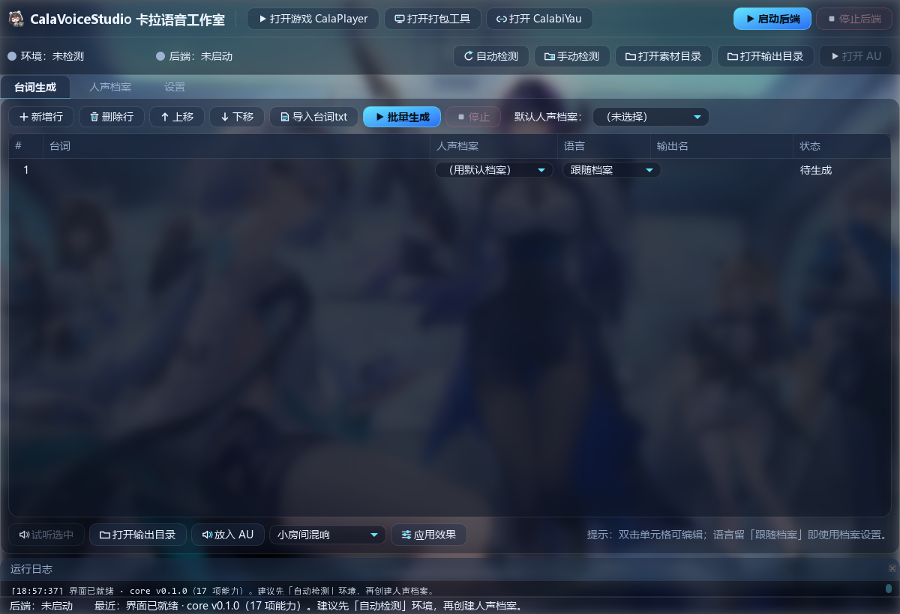
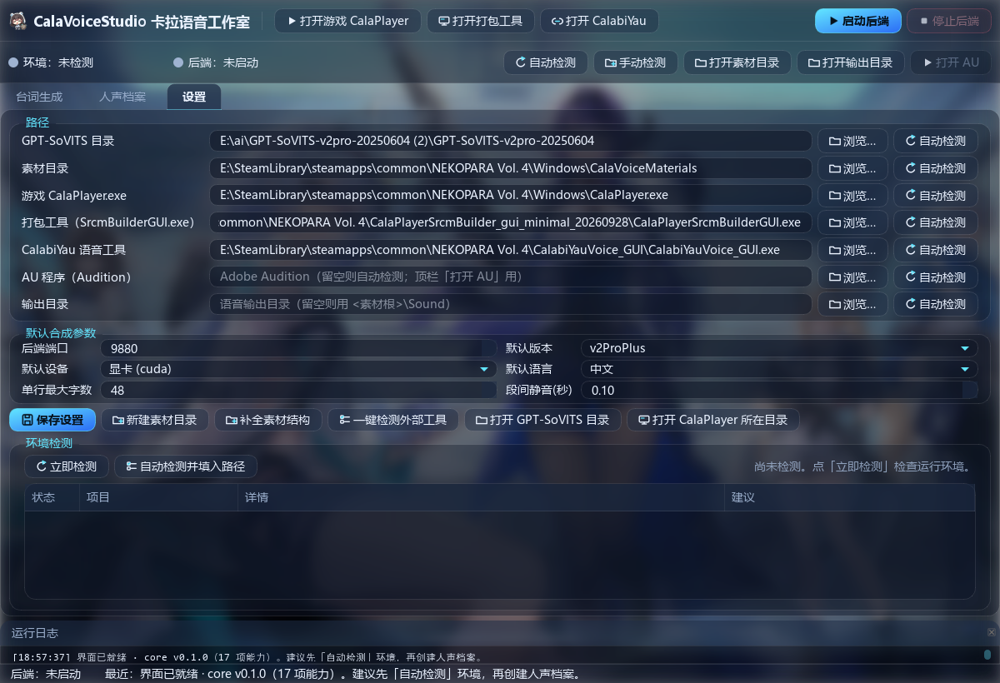

# CalaVoiceStudio · 卡拉语音工作室

**v0.1.0** · Windows · MIT

写台词 → 选人声 → 调本机 GPT-SoVITS 合成 → 导出 CalaPlayer 素材规范的 48 kHz wav → 一键打开打包工具。
全部操作在一个窗口里完成，零命令行。生成的语音可以**一键放进 Adobe Audition** 加混响/延迟，
也可以直接用软件内置的「快速效果」原地套混响、延迟、音量标准化。





> 想直接用：到 [Releases](https://github.com/qq241786/CalaVoiceStudio/releases) 下载
> `CalaVoiceStudio-0.1.0-win64.zip`，解压后双击 `CalaVoiceStudio.exe`。
> 前置条件只有一个：**本机已装好 GPT-SoVITS**（含它自带的 `runtime\python.exe` 与 `ffmpeg.exe`）。

- 协议：[MIT](LICENSE)（随便改、随便商用，出问题别找我）
- 素材声明：`assets/` 里的壁纸与头像是**卡拉彼丘相关游戏素材**，版权不属本仓库，详见 [NOTICE.md](NOTICE.md)
- 更新日志：[CHANGELOG.md](CHANGELOG.md)

## 一、运行

**双击 `dist\CalaVoiceStudio\CalaVoiceStudio.exe`** —— 已打包好，不用装 Python、不用命令行。

- 整个 `dist\CalaVoiceStudio\` 文件夹是**便携**的：可以整个复制到任意位置（例如游戏目录），双击里面的 exe 即可。
- 配置、人声档案、日志都在 exe 旁边的 `data\`，跟着文件夹走。
- 冷启动到可操作约 3 秒。

从源码运行（改代码或排障时用）：双击 `launch.bat`，或 `python main.py`；要求 Python 3.11+ 且装了 PySide6。

重新打包：`powershell -ExecutionPolicy Bypass -File .\build_exe.ps1`（脚本全 ASCII，PyInstaller 6.22.3 + Python 3.14 + PySide6 6.11 实测兼容）。

## 二、首次使用（设置页）

> **首次运行**：配置全是空的，点「自动检测」让程序扫盘找 GPT-SoVITS 与素材目录即可
> （也可以手动填/浏览）。原始说明：config.json 里的 GPT-SoVITS 目录 / 素材根 / CalaPlayer 程序三项已填好，
> 人声档案里已有一条 **BaiMo**（v2ProPlus + `BaiMo-e25.ckpt` + `BaiMo_e8_s264.pth`，参考音频在 `data\refs\BaiMo_ref.wav`）。
> 打开软件 → 台词生成页写一行 → 点「批量生成」即可出声。要换音色就在人声档案页新建档案。
> 素材根（示例：`<游戏目录>\Windows\CalaVoiceMaterials`）下的 bg/BGM/Sound/Ambient 会自动创建。

1. **GPT-SoVITS 目录**：指向含 `api_v2.py` 与 `runtime\python.exe` 的目录。
   可点「自动检测」让程序自己扫盘查找，也可手填/浏览。
2. **素材根目录**：CalaPlayer 的素材根 —— 它本身是一个**装着四个子文件夹的文件夹**：

   ```
   CalaVoiceMaterials\          <- 素材根（CalaPlayer 里选这个文件夹）
   ├── bg\                      <- 背景图
   ├── BGM\                     <- 背景音乐
   ├── Sound\                   <- 音效/人物语音（本软件导出到这里）
   └── Ambient\                 <- 环境音
   ```

   两个按钮：
   - **新建素材目录**：先选父目录（例如游戏目录下的 `Windows`），软件会自动新建 `CalaVoiceMaterials` 文件夹，
     并在里面建好 bg / BGM / Sound / Ambient，然后把素材根指向它。**推荐用这个**，别把游戏目录本身当素材根。
   - **补全素材结构**：当前素材根里缺哪个子目录就补哪个。

   语音导出到 `<素材根>\Sound\`。示例（程序不写死，任何位置都行）：
   `<游戏目录>\Windows\CalaVoiceMaterials`
3. **三个外部工具开关（互相独立）**：
   - 「游戏 CalaPlayer.exe」→ 顶栏 **▶ 打开游戏 CalaPlayer**
   - 「打包工具 CalaPlayerSrcmBuilderGUI.exe」→ 顶栏 **🛠 打开打包工具**
   - 「CalabiYauVoice 语音工具」（`CalabiYauVoice_GUI.exe`，卡拉彼丘 Wiki 语音下载/音频转换工具）
     → 顶栏 **打开 CalabiYau**；启动前会把它的默认保存/转换目录补成本软件的语音输出目录
     （只补 `%APPDATA%\CalabiYauVoice\prefs.json` 里空着的键，不动你已有的设置）

   三项各自都有 浏览 / 手填 / **自动检测**。除了逐项检测，设置页还有一个
   **「一键检测外部工具」**：一次把三个工具 + Adobe Audition 全部找出来并自动保存。
   自动检测是**真的扫盘**（跳过 Windows、Program Files、AppData 等系统目录），但**不用每次傻等**：

   - 检测结果会写进 `data\detect_cache.json`，下次启动先验证缓存，**毫秒级命中**；
   - 优先查 Steam 库（注册表 `SteamPath` + `libraryfolders.vdf`）、已配置路径的相邻目录，
     只有全都找不到时才退回全盘扫描（本机全盘约 7 秒，跑在后台线程、界面不卡）；
   - 启动时发现哪个路径缺失/失效才会自动探测，**已经配好的不会重复扫盘**；
   - 检测/选择成功后立即保存，不再需要"记得点保存设置"。
4. **AU 程序（Adobe Audition）**：顶栏「打开 AU」用。留空即自动检测
   （注册表 App Paths → Program Files\Adobe → 开始菜单），也可手填 / 浏览。
5. **输出目录**：语音写到哪里。留空 = `<素材根>\Sound`；也可单独指定一个目录
   （顶栏「打开输出目录」始终打开最终生效的那个）。每行都是 手填 + 浏览 + 自动检测 三通道。
6. 端口默认 9880（被占用就改一个），默认版本 v2ProPlus、设备 cuda。
7. 点「手动检测」或「自动检测」，确认 **12 项检查**全部通过。

## 三、人声档案页

一条「人声档案」= 一段参考人声 + 它的文字 + 用哪套模型。

| 字段 | 说明 |
| --- | --- |
| 参考音频 | 3~10 秒、单人、无伴奏、无混响的干净人声（wav/mp3 均可） |
| 参考文本 | 这段音频**逐字**对应的文字（必须一致，否则音色会跑偏） |
| 版本 / 设备 | v1 / v2 / v2Pro / v2ProPlus / v3 / v4；cuda 或 cpu |
| GPT 权重 / SoVITS 权重 | 留空 = 用该版本底模；填了就用你训练好的专属权重（可在下拉里选，也可浏览） |
| 语速 | 0.8~1.3 常用 |

权重目录会被自动扫描（`GPT_weights*`、`SoVITS_weights*`），也可在设置里手动加目录。
点「用测试句试听」验证音色，然后「保存」。

## 四、台词生成页

1. 一行一句；「人声档案」列可逐行选不同音色。
2. 「导入台词txt」：每行一条台词，一次性倒进表格。
3. 勾选/取消行（双击 # 列切换），点「批量生成」。
4. 每行状态实时更新；完成后点「试听选中」，或「打开输出目录」直接看文件。
5. **放入 AU**：在表格里选中若干行（不选 = 全部已生成的语音）→ 点「放入 AU」，
   Adobe Audition 会直接打开这些 wav。在 AU 里加混响 / 延迟 / EQ，**保存即写回原文件**，
   回到软件直接生成/打包即可。
6. **快速效果**：不想开 AU 时，在「应用效果」左边选一个预设
   （小房间混响 / 大厅混响 / 延迟回声 / 音量标准化）→ 点「应用效果」。
   软件用 ffmpeg 原地处理（仍是 48 kHz / 16-bit / 单声道），原文件自动备份为 `xxx.original.wav`。
   想撤销：删掉处理后的文件，把 `xxx.original.wav` 改名回 `xxx.wav` 即可。

导出文件名规则：`v001_档案名.wav`；也可在「输出名」列手写（自动补 `.wav`）。

## 四·五、界面

深色毛玻璃风格：壁纸真模糊铺底（`QGraphicsBlurEffect`），面板是半透明圆角玻璃，主按钮青→蓝渐变。
窗口/任务栏/程序图标都是头像（`assets/app.ico`，16~256 多尺寸）。
资源管理器里的文件夹图标保持 Windows 默认（不写 `desktop.ini`，不动文件夹属性）。
启动只做存在性自查（毫秒级），**不会**每次开机就扫盘：外部工具路径优先用
`data\detect_cache.json` 缓存和 Steam 库快速定位，只有路径缺失且缓存过期时才全盘探测。

## 五、导出规格（CalaPlayer 要求）

**48000 Hz / 16-bit PCM / 单声道 wav**，由自带 ffmpeg 转码并在生成后校验，不达标该行会标红报错。

## 六、后端与日志

- 首次生成时自动拉起 `api_v2.py`（工作目录=GPT-SoVITS 根，无窗口，日志在 `data\logs\api_*.log`）。
- 切换「版本」会自动重启后端；只切权重则热切换、不重启。
- 退出程序会自动结束后端进程。
- 全部用户数据在 `data\`：`config.json`、`voices.json`、`script.json`、`logs\`。

## 六·五、性能与显存（重要）

- **合成很吃显存**：v2ProPlus 半精度推理约需 2~3 GB。本机是 RTX 4050 Laptop（6 GB），
  若同时开着游戏或别的推理程序，可用显存可能只剩 1 GB 左右 —— 此时 CUDA 会退到共享内存，
  推理会慢 50~100 倍，表现为"卡住不动"而不是报错。**批量生成前建议关掉游戏**。
- 后端每次启动都会把显存写进日志（`data\logs\api_*.log`）：
  `显存：NVIDIA ... 6141 MiB, 1227 MiB`；低于 2500 MiB 会追加一行警告。
  想更早预警可把 config.json 里的 `min_free_vram_mb` 调大（例如 3500）。
- **卡死自愈**：单条请求超时 = `20 + 4×字数` 秒（上限 180 秒，27 字约 128 秒）。
  一旦超时或连接被重置，程序会**自动重启后端、重放权重、重试这一条**；再失败才标红，
  并提示"关掉占显存的程序"。整批不会因为一条失败而连锁失败。
- **残留后端自动清理**：上次崩溃/被强杀留下的后端占着端口时，下次启动会自动识别并结束它
  （只认本软件 `data\runtime\tts_infer_*.yaml` 启动的进程；别人的 GPT-SoVITS 会提示换端口，不误杀）。
- **预热 + 后台预启动**：软件一启动就在后台拉起后端并预热（约 30+10 秒），
  你写台词的时间把这段等待吃掉，第一次点「批量生成」就直接出音。
  启动时若可用显存 < 1900 MiB 会**自动跳过**预启动并在日志里说明原因（不占你的显存）。
  想关掉这个行为：把 config.json 里 `auto_start_backend` 改成 `false`。
- **长句自动分段**：单行超过「单行最大字数」会自动按标点分段合成再拼成一条 wav。
- 生成过程中「状态」列实时显示 `生成中… 12s`，完成后显示 `完成 8.3s`；
  批量期间后端探活只查进程、不发 HTTP（状态栏显示 `后端：就绪（生成中）`），既不抢推理请求也不会误报"未启动"。

## 七、自检（排障）

```bat
python selftest.py                          :: 只做环境检查（12 项）
python selftest.py --detect                 :: 额外跑一次外部工具快速检测（不写配置）
python selftest.py --ref 参考.wav --ref-text "参考文本"   :: 加跑一次真实合成 + 48k 转码校验
```

## 八、常见问题

| 现象 | 处理 |
| --- | --- |
| 检测不到 GPT-SoVITS | 确认目录下有 `api_v2.py` 和 `runtime\python.exe`；用浏览手选 |
| 检测不到 CalaPlayer / 打包工具 / CalabiYau | 设置页点「一键检测外部工具」，一次补齐四项并保存；仍找不到就浏览手选 |
| 每次启动都要重新检测工具路径 | 正常版本不会：检测结果会写进 `data\detect_cache.json` 并在启动时秒命中；若缓存文件被删（或路径搬家），首次会重扫一次 |
| 想给语音加混响 / 延迟 | 台词页选中行 →「放入 AU」用 Audition 细调；或直接选「快速效果」预设原地处理（自动备份原文件） |
| 快速效果后想恢复原声 | 用同目录的 `xxx.original.wav` 改回 `xxx.wav` |
| 后端启动超时 | 看 `data\logs\api_*.log` 尾部；首次加载显存要 1~3 分钟 |
| 生成卡很久不动 | 先看日志里的显存警告，关掉游戏/其它占显存的程序；程序会自动重启并重试一次 |
| 提示"端口 9880 已被另一个 GPT-SoVITS 后端占用" | 你另开了一个 GPT-SoVITS（webui 或另一个本软件实例），关掉它或在设置页换端口 |
| 合成报 ref_audio_path is required | 该档案参考音频为空或路径失效 |
| 导出不是 48000/16bit | ffmpeg 路径未检测到，检查设置页第 4/5 项 |
| 端口占用 | 设置页换端口（程序会重启后端） |
